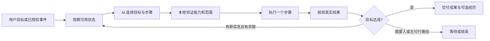
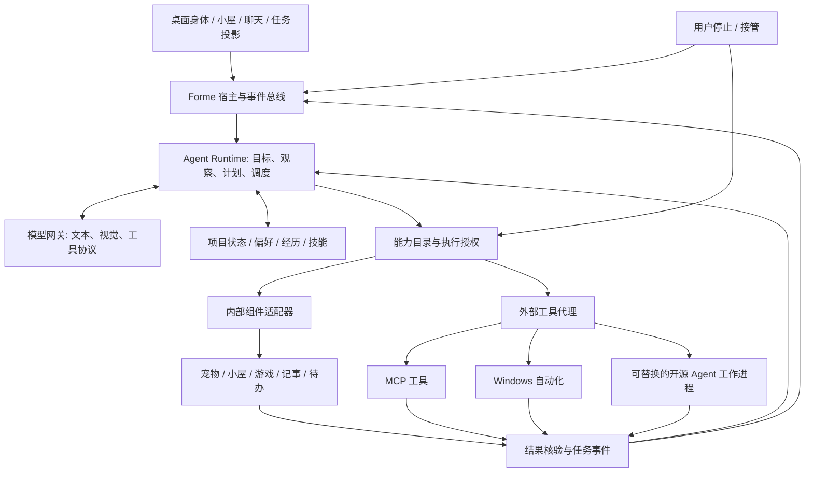

# Forme 未来桌宠助手设计方案

**定位：一个有身体、有生活、能协作、能操作电脑的 AI 伙伴。**  
副标题：娱乐陪伴 × 工作辅助 × 自主目标 × 开放 Agent 能力  
初稿日期：2026-10-14｜复核日期：2026-10-15｜项目基线：`D:\forme`｜方案版本：1.2

本文基于已核对源码、既有设计与实施记录，以及开源项目官方资料编写。初稿核对的仓库提交为 `2124068`；当时工作区还包含此前桌面随机走动的未提交修改。本文是下一阶段的产品与架构设计，不代表所列新能力已经实现。本次只编写和复核设计文档，未接管电脑、安装外部 Agent、调用用户配置的付费模型或修改应用代码。

本次现状分析采用静态代码核对，未重新执行应用验收。文中的性能、成功率和周期均明确区分为设计目标或估算。旧的 R0/R1 记录属于阶段快照，不能覆盖后来已经加入的合作玩法和后台自主功能。

**v1.2 审查结论：** 产品方向与现有技术基础相容；v1.1 尚缺若干执行前提，本次已在对应章节补齐。修订重点为项目资料生命周期（13.4）、目标变更与结果验证（9）、外部代理预算和停止条件（11.2、14）、崩溃恢复及组件覆盖门槛（16.3）。P0/P1 可据此进一步拆分实施任务，P2 的外部工具组合仍需小规模真实联调后定型。

**实施进展（2026-10-15）：** 已启动 P0，代码与验收结果见 [P0 可靠性实施记录](D:/forme/docs/审核意见与下一步计划/P0可靠性实施记录_2026-10-15.md)。第 2 节保留设计时的现状快照，后续实现状态以实施记录为准。

**阶段推进（2026-10-15）：** P1 八批样板已进入 0.6.9。P2 首个小切片在 0.6.10 增加项目内“指定网页静态只读来源”，不含浏览器会话、Playwright MCP 或桌面控制；接口与安全边界见 [P2 指定网页来源实施记录](D:/forme/docs/审核意见与下一步计划/P2_指定网页来源实施记录_2026-10-15.md)。这只验证单页读取到项目草稿的来源闭环，不能替代方案中的 MCP/Playwright 真实联调。

P2 第二个小切片在 0.6.11 支持把已生成草稿保存到用户明确选择的 Markdown/文本路径，并回读核对，不保存原始资料或授权信息。实现记录：[P2 项目草稿文件输出实施记录](D:/forme/docs/审核意见与下一步计划/P2_项目草稿文件输出实施记录_2026-10-15.md)。浏览器MCP仍未开始接入，待具备可验证的网络出口隔离与受控运行环境后再联调。

0.6.12（2026-10-16）补上网页连接/HTTP/传输故障的界面可恢复错误和离线边界检查，见 [网页来源故障与边界验证](D:/forme/docs/审核意见与下一步计划/P2_网页来源故障与边界验证_2026-10-16.md)。

0.6.13（2026-10-16）接入官方MCP C# SDK并运行本机客户端/工具进程握手与调用；项目网页来源经唯一内置只读工具返回、内容哈希核验和进程回收后使用，见 [MCP宿主与只读网页进程](D:/forme/docs/审核意见与下一步计划/P2_MCP宿主与只读网页进程_2026-10-16.md)。这完成MCP宿主的首个受限接入流程；工具为随应用打包的可信代码，尚未接入Playwright、任意外部MCP服务器或电脑操作，相关隔离与兼容工作仍待后续。

0.6.14（2026-10-16）扩展纸船合作的实测反馈：目标码头未到达时，在同一局、布局、模型和分享授权仍有效的十分钟内，用户可主动请求一次新方案；模型收到上一轮目标、实际码头、本轮布局与本机重新模拟的候选结果，仍须用户确认才能出发。每轮各计一次模型请求，不自动连续规划；见 [P3 纸船实测反馈规划](D:/forme/docs/审核意见与下一步计划/P3_纸船实测反馈规划_2026-10-16.md)。136项核心测试和26类合作玩法场景通过；首次完整WPF冒烟在既有移动测试失败，后续完整复跑通过。该批验证一次真实结果反馈闭环，不代表持续自主玩法或真实服务质量已完成。

0.6.15 开始通用目标重规划的首个安全切片：仅对首步移动明确因路径阻挡而失败、没有任何前序完成步骤的目标，提供一次用户触发的重规划草稿；原目标与失败回执须由用户检查并手动发送，后续计划仍走现有能力白名单、整体预检、逐步回执和30秒上限。没有后台调用或自动重放。权限拒绝、其它失败、已完成前序步骤和不确定结果不进入本批范围。实现与验证见本次目标重规划记录；长期委托、更多可恢复失败类型与外部电脑 Agent 仍未完成。

0.6.16 增加崩溃后本机笔记、待办或提醒产物的人工核对：只有目标账本步骤为“不确定”、目标已中断且稳定产物 ID 能在对应本机表中读回时，才显示确认入口；核对只更新账本，不重放写入，也不自动续跑被跳过步骤。专门记录见 [目标中断产物核对实施记录](D:/forme/docs/审核意见与下一步计划/P1_目标中断产物核对_2026-10-20.md)。这减少了“产物已写入但回执未落账”的歧义，仍不恢复原计划正文或处理未知外部副作用。

0.6.17 将通用目标的一次手动重规划范围扩展到“首步移动目标当前不可用”：仅当首步明确以 `TargetUnavailable` 失败或整体预检明确返回该结果，且所有后续步骤均跳过时，才可准备一次新草稿。草稿生成不调用模型、不执行动作；只有用户检查并手动发送才发起请求。权限拒绝、取消、不确定结果、其它错误和任何已执行步骤仍不可重规划。实现与验收见 [首步目标不可用的有限重规划记录](D:/forme/docs/审核意见与下一步计划/P1_首步目标不可用的有限重规划_2026-10-20.md)。

0.6.18 补上纸船在实际到岸后、合作目标账本写回前发生中断的核对路径：本机保留最多50条带局次标识的到岸回执；应用恢复将对应运行记为中断后，只有目标最后一步的局次与回执完全相同且此前步骤已完成时，合作执行记录才提供人工确认。确认只将账本回写为该码头实际到岸并移除已核对回执，不再放船、不重放步骤或调用AI。见 [纸船中断后的本机局次核对](D:/forme/docs/审核意见与下一步计划/P1_纸船中断后的本机局次核对_2026-10-20.md)。藏物局次仍未持久化；其它玩法和外部副作用仍需各自的安全恢复设计。

P1 第一批资料协作、目标账本与草稿链的进展见 [P1 第一批实施记录](D:/forme/docs/审核意见与下一步计划/P1_项目协作与目标账本实施记录_2026-10-15.md)。这尚不代表通用 Agent、全部组件覆盖或电脑控制已经完成。

P1 第二批完成了待办建议到正式待办的用户确认投影，进展见 [P1 第二批实施记录](D:/forme/docs/审核意见与下一步计划/P1_待办建议投影实施记录_2026-10-15.md)。统一全部组件的 AI 目标执行协议仍待后续实现。

P1 第三批加入统一的静态能力目录，并让伙伴动作、工作操作和项目草稿提示及解析白名单共用目录定义。进展见 [P1 第三批实施记录](D:/forme/docs/审核意见与下一步计划/P1_统一能力目录实施记录_2026-10-15.md)。运行中组件观察、逐步目标计划和跨模块统一执行器仍未完成。

P1 第四批将双视图的动态快照接入聊天可选分享与本机旧计划核对，见 [动态能力快照实施记录](D:/forme/docs/审核意见与下一步计划/P1_动态能力快照与执行核对_2026-10-15.md)。覆盖当前伙伴短活动的观察和执行前校验；通用跨模块目标循环和外部电脑工具仍待后续实施。

P1 第五批加入有限跨组件计划，覆盖记事/待办/提醒/本机查询与有限伙伴动作的整体预检、逐步回执和执行账本，见 [跨组件目标执行记录](D:/forme/docs/审核意见与下一步计划/P1_跨组件目标计划与执行账本_2026-10-15.md)。这仍为一次规划、有限本机执行；长期目标重规划、复杂玩法和外部 Agent 仍待后续实施。

P1 第六批统一资料项目与跨组件计划的任务卡，覆盖小屋各页面与桌面聊天窗，显示当前步骤、实际产物、来源及停止，并增加清除项目资料后进入既有玩法的明确入口，见 [统一任务卡实施记录](D:/forme/docs/审核意见与下一步计划/P1_统一任务卡与工作玩法交接_2026-10-15.md)。本批未扩展模型执行协议；多轮重规划、游戏策略闭环和真实模型联调仍待完成。

P1 第七批将藏物与纸船作为联合目标的末步接入，增加本机本局观察、等待参与、实际结果回写及旧局隔离，见 [联合目标与玩法结果实施记录](D:/forme/docs/审核意见与下一步计划/P1_联合目标与玩法结果核对_2026-10-15.md)。当前覆盖伙伴藏/玩家找和纸船准备/放船；AI搜索策略、合作建议的统一调度与有限重规划仍待后续。

P1 第八批将独立AI合作藏物/纸船接入任务卡与执行账本，藏物可根据实际已检查项进行一次有限重规划，纸船区分建议、人工确认与实际到岸，见 [AI合作玩法与有限重规划实施记录](D:/forme/docs/审核意见与下一步计划/P1_AI合作玩法任务与有限重规划_2026-10-15.md)。沿用原主动按钮与独立授权，未扩展聊天协议或联网数据范围；通用目标重规划、真实模型对照验证、长期委托及外部电脑工具仍待后续。

## 1. 产品主张：让伙伴拥有能被看见的行动力

Forme 的长期形态，是住在用户电脑里的数字伙伴。它能陪用户玩一局有策略的游戏，也能把一句工作目标变成可检查的文件、笔记和任务；用户离开时，它可以在事先约定的范围内继续一个小项目，回来后展示真正做出的成果。

核心体验可以用一句话表达：

> “你负责决定什么值得做，我会理解目标、使用工具、检查结果，也会和你一起发现有趣的事。”

未来感来自三个可感知的变化：

1. **身体与行动一致。** 宠物正在整理资料，桌面旁就出现真实的资料卡和任务进度；走到书架旁时，它能取出有来源的知识卡。动作失败时会停下并说明实际阻碍。
2. **世界具有延续性。** 用户和宠物设计过的纸船、完成的项目、改造的小屋、学会的流程，会留下可编辑、可重玩、可继续的作品。
3. **能力能够成长。** 新接入的组件、应用适配器和 Agent 工具会成为它可发现的能力。用户不用记住几十个页面入口，也不必为每种自然表达编写匹配规则。

产品的竞争力应落在“共同完成的事情”上：同一个伙伴能理解当下目标、参与选择、执行动作、应对变化，并把结果带回长期关系中。角色形象、声线、动画和界面用于表达这些能力。

## 2. 当前实现：已有基础与真实差距

### 2.1 已有能力应继续复用

| 领域 | 当前源码已具备 | 下一阶段要跨越的差距 |
|---|---|---|
| 角色与空间 | 桌面伙伴、小屋/户外、寻路、走跑、若干动作、模型切换 | 统一动作主体；保证真实位移、可见表现和执行结果一致 |
| 本地玩法 | 家具编辑、生活事件、藏物、投球、纸船、成长与收藏 | 从单次互动发展为有选择、有变化、有作品的持续循环 |
| AI 动作 | 自然语言识别、结构化动作、预检、有限步骤执行 | 统一全部组件接口；目标规划和结果反馈尚未形成通用循环 |
| 自主生活 | 用户发起的活动选择、默认关闭的后台选择、额度、冷却、抢占 | 从候选菜单选择发展为有结果的多阶段自主项目 |
| 共同经历 | 最多 200 条经历，可向 AI 提供最近 4 条启用记录 | 按目标检索、来源追踪、偏好更新与长期承诺 |
| 示范学习 | 最多 20 个三步动作组合，可重放 | 当前是动作宏；需要参数、前置条件和迁移验证，才能称为可复用技能 |
| 合作藏物 | AI 根据公开候选和线索安排搜索，本局最多两次规划 | 主动追问、矛盾线索处理、双方不同角色、更多策略空间 |
| 合作纸船 | 本机模拟三个候选，AI 选择，用户确认后采用 | 多目标实验、失败分析、有限探索与真正的新方案生成 |
| 工作辅助 | 记事、待办、提醒、专注；AI 可创建部分记录和查询 | 授权资料读取、任务更新、真实产物、跨应用工作流程 |
| 模型与附件 | 多服务适配、图片/PDF/文本/DOCX 等输入路径 | 模型能力验证、统一工具调用、视觉与长任务策略 |
| 电脑与外部 Agent | 未发现业务层面的 MCP、通用工具循环和跨应用控制实现 | 新建工具宿主、Windows 执行器、浏览器适配和外部 Agent 桥接 |

证据入口：[活动观察与选择](D:/forme/src/Forme.Core/ActivitySelection.cs)、[自主生活](D:/forme/src/Forme.App/CompanionLifeController.cs)、[经历与合作玩法数据](D:/forme/src/Forme.Core/CompanionLife.cs)、[合作玩法 UI 与执行](D:/forme/src/Forme.App/CooperativePlay.cs)、[生产力协议](D:/forme/src/Forme.Core/ProductivityIntentProtocol.cs)、[服务能力声明](D:/forme/src/Forme.Core/AiProviderAdapters.cs)。这些文件证明实现路径存在，不等于所有平台与模型已完成真实联调。

当前自主活动最多提供 12 个候选，执行计划最多 3 步、30 秒。后台有十分钟冷却、每小时至多 6 次、滚动 24 小时默认 20 次的调用控制，用户主动操作优先。现有工作查询主要返回匹配条数并引导查看页面，AI 尚不能读回笔记正文、更新或完成待办。这些是未来升级的基线，不能把当前实现描述为通用电脑 Agent。

### 2.2 必须先补的基础问题

- **同一只宠物的两个视图仍可能走不同控制路径。** 自主选择已有显式视图绑定，部分普通动作仍依据 `House is not null` 等条件路由。所有动作需要统一指定桌面或小屋主体。[CompanionControl.cs](D:/forme/src/Forme.App/CompanionControl.cs)
- **桌面走动问题还缺完整实机闭环。** 前一轮已修改启动等待与随机选点，但尚不能据此证明用户持续静止的问题已经彻底解决。下一轮要同时检查选中值、暂停原因、动画驱动、原生窗口实际位移和新版二进制来源；不能把两秒等待当作已证实的唯一根因。[PetWindow.cs](D:/forme/src/Forme.App/PetWindow.cs)、[DesktopWander.cs](D:/forme/src/Forme.Core/DesktopWander.cs)
- **提醒调度依附小屋窗口。** 计时器位于 `MainWindow`，窗口关闭会停止调度；静态分析显示，仅保留桌宠或托盘时存在提醒不继续检查的风险。需要迁至应用宿主并实测，才能承诺常驻助手可靠提醒。[ProductivityPages.cs](D:/forme/src/Forme.App/ProductivityPages.cs)、[MainWindow.cs](D:/forme/src/Forme.App/MainWindow.cs)
- **组件能力描述分散。** 生产力协议已有提醒创建能力，但部分通用模型说明仍否认提醒能力。后续提示词应由实际工具目录生成。[AiClient.cs](D:/forme/src/Forme.Core/AiClient.cs)
- **当前工具能力没有通用实现。** 适配器中的 `ToolCalling` 基础声明是 `Unsupported`。这是当前应用实现状态，不能据此判定对应服务商本身不支持工具调用。[AiProviderAdapters.cs](D:/forme/src/Forme.Core/AiProviderAdapters.cs)
- **聊天附件尚不是项目资料库。** 当前附件是本次读取的快照，不保留原路径；成功完成后清理重试副本，聊天只存附件名称说明，后续消息不自动重传。带附件请求也不走动作意图路由。P1 的多轮资料协作需要另建有范围、有来源的项目资料路径，不能直接沿用普通附件的隐私说明。[AiAttachment.cs](D:/forme/src/Forme.Core/AiAttachment.cs)、[ChatAttachments.cs](D:/forme/src/Forme.App/ChatAttachments.cs)、[Controller.cs](D:/forme/src/Forme.App/Controller.cs)

这些问题属于下一阶段前置验收，本设计文档不顺带修改它们。

## 3. 用户看到的产品：一个伙伴，五个入口

### 3.1 桌面身体

宠物是入口，也表达实际状态。用户可以拖动、抚摸、招呼、丢一个虚拟道具，或把允许处理的文件拖给它。桌面与小屋共享身份、偏好和任务进度，每个身体拥有独立位置和动作执行器。

窗口边缘可以成为视觉上的停靠点；鼠标附近是默认避让区。宠物的点击穿透、尺度、模型朝向、遮挡、多屏和不同 DPI 必须先稳定。窗口移动后可以重新寻找停靠位置，不能因此擅自移动用户正在操作的应用。

### 3.2 任务投影

接到工作目标时，宠物旁出现一张轻量任务卡，显示目标、下一步、已完成产物和“暂停/接管/停止”。多步任务展开成可折叠时间线，已验证的步骤才显示完成。

例如：`周会准备 → 已读 2 份资料 → 正在生成提纲 → 等你确认待办日期`。点击“已读 2 份资料”能看到来源，点击产物能打开文件。执行日志和原始 JSON 留在诊断层，聊天正文保持正常交流。

### 3.3 小屋世界

小屋既是玩耍空间，也是成果陈列空间：书架放知识卡，工作台放项目草稿，窗台放纸船收藏，墙面显示用户主动选择展示的里程碑。工作内容只在授权后转成展品；敏感文件名不自动挂到小屋里。

家具产生真实玩法影响。例如书桌与灯组合改善阅读活动可用性，空旷区域增加投球路线，靠近窗边的试验台改变纸船挑战条件。改变布局的意义来自玩法约束和选择。

### 3.4 伙伴手册

集中展示它记住的偏好、共同经历、当前承诺、已经掌握的技能。每条都能看来源、纠正、暂停使用或删除。用户能看见“你说过不喜欢工作时被邀请”，也能将它改为“午休时可以”。

### 3.5 能力装配台

以用途组织能力包：浏览器、文件整理、会议准备、知识学习、Windows 操作、创作工具。每个能力包显示支持哪些任务、需要哪些应用/资料、是否联网、测试状态和停止方式。安装一次后，日常对话可以直接调用，不要求用户理解 MCP 或编排框架。

视觉建议：保留伙伴的温暖材质，小面积使用柔光轨迹、半透明任务卡、轻量空间投影和可展开的回忆地图。减少动效时保留文字与状态结构；未来感不能依赖高亮闪烁或持续占用 GPU。

## 4. 四种使用方式与一天的体验

| 方式 | 用户期待 | 宠物的行为 |
|---|---|---|
| 陪伴 | 不打扰，但有生命感 | 本地身体动作、允许的生活活动、低频邀请 |
| 共创 | 我们一起玩或完成作品 | 分工、提出选择、根据玩家操作调整策略 |
| 助理 | 帮我完成一个明确目标 | 拆解步骤、使用资料和工具、验证结果、交付产物 |
| 受托 | 在这段时间和范围里自行推进 | 持续一个有限项目；遇到越界、预算或必要决策时停下 |

这些是体验方式，不直接等同于权限等级。选择“受托”仍需知道受托的是哪个目标、哪些资料与工具；选择“陪伴”也能在已有授权下帮用户记一条待办。

**上午。** 用户说：“用我选的两份资料准备今天的周会。”宠物确认必要的输出要求，在旁边展开计划。已有明确授权的资料读取与草稿创建直接进行；缺日期时把待办标为待确认，不编造截止时间。

**工作中。** 用户补充：“先只整理风险，结论晚点写。”伙伴更新任务目标，保留已读资料与完成证据，不从头重做。键盘和鼠标由用户接管时，电脑操作暂停，资料分析可以在允许范围内继续。

**休息时。** 用户选择玩一局“找出矛盾线索”。宠物根据公开证据决定先问问题还是检查家具；用户的提示会改变策略。完成后双方把喜欢的谜题存成可重玩的卡片。

**用户忙碌时。** 用户曾允许宠物在小屋制作“纸船展览”。宠物有限地整理已授权的游戏作品，生成布局草稿；用户回来后看到一件真实成果。没有新条件时，它可以安静等待，不靠反复联网制造忙碌感。

## 5. 八个能持续玩的互动循环

每个循环都应包含：用户选择 → AI 决策 → 可见执行 → 结果影响 → 可继续的变化。奖励优先是作品、发现和能力，不能只靠每日领币维持参与。

### 5.1 共同任务：工作结果成为可选择保留的纪念

- **用户做什么：** 给目标、指定资料和应用，决定优先级，中途调整要求。
- **宠物自主做什么：** 查找缺口、拆分计划、选择工具、验证产物，必要时提出最小问题。
- **留下什么：** 有来源的会议提纲、真实任务、文件草稿和恢复点；用户可选择留下一张项目纪念卡。
- **为什么会再玩：** 不同工作带来不同分工和技能成长；协作偏好从用户实际采纳与纠正中更新。
- **停止与恢复：** 停止后列明完成项、未完成项与草稿位置；恢复前检查资料版本。

此循环建立在现有记事、待办和专注功能上。休息小游戏由用户选择，拒绝邀请不会扣关系值，也不锁住工作功能。

### 5.2 公平侦探：藏物变成有信息差的推理游戏

用户藏物、提供线索，或交换角色；AI 选择询问、检查或修正假设。每局有检查次数或时间约束，可以给真实线索、模糊线索，也可在明确的挑战模式里给干扰线索。评分围绕推理过程和资源使用，而不是是否猜中了随机答案。

隐藏答案由本机裁判单独保存。模型可见的只有公开家具、已经检查的结果和本局线索；加入问询能力也不能开放答案工具。把某局保存为谜题后，游戏实例的答案仍不进入玩家代理的检索库。

可扩展“共同找第三方留下的线索”：AI 与用户各掌握一部分公开信息，通过交流拼合答案。AI 的价值体现为追问、分工和处理矛盾。用户可随时揭晓、退出或切换离线模式。

### 5.3 物理创作实验室：让纸船有实验与策略

用户选择目的地，以及“更快、更稳、经过两个观察点”等目标，决定哪些叶片由自己摆放。AI 先提出可检验的方案，调用本机模拟器做有限试验，根据真实结果修正。

首个扩展建议增加三个变量中的两个：一片额外叶片、途中障碍、允许的调整次数。先保持空间小而可解释，再开放更大组合。用户与 AI 各控制部分变量，形成合作而不是观看自动求解。

每次保留蓝图、环境参数、失败原因和最佳航行，可以改造、重放和分享。比较方案时，AI 应说明速度与稳定性的取舍。当前“三个已模拟候选中选一个”仍可作为快速建议模式，升级后的实验模式要单独验收。

### 5.4 会变化的小屋：空间设计决定生活可能性

用户提出“做一个适合阅读又能玩球的小角落”，圈出不能改动的区域。宠物检查通路、动作空间与物件能力，给出两个有不同取舍的预览。用户移动一件家具后，AI 重新评估受影响部分。

持续变化来自可保存的布局版本、用途和真实使用结果。例：第一次球滚到桌脚后，宠物提出扩大通路，而不是随机换家具。空间改造可以解锁新的玩法组合，已有基础玩法始终可用。

冻结区域、撤销预览和恢复旧版本都是常驻能力。未经预授的正式保存需要用户采纳；伙伴不能为了“显得有自主性”不断重摆小屋。

### 5.5 技能工坊：教会一个流程，再换条件挑战

用户示范一次操作，例如“把这份学习卡放入项目笔记，并创建明天的复习提醒”。AI 提议把资料、项目与时间变成参数，并说明完成标准。

接下来不是直接宣布学会，而是在另一份用户选择的材料上试运行。成功后形成技能卡：适用条件、输入、允许工具、验证方式、版本和示例。失败时定位是对象变了、缺权限还是工具不支持，再由用户决定修订。

技能可以在游戏与工作之间迁移设计思路，但权限分开。游戏里学会“把球放回盒子”不自动获得移动真实文件的权限。初期技能使用声明式步骤和工具引用，后续才考虑隔离环境中的代码技能。

### 5.6 桌面共游：把工作空间变成轻量游乐场

用户圈定屏幕上可玩的区域，宠物在窗口边缘、虚拟桥梁和任务卡之间移动。可以把三张虚拟任务卡送到工作台、合作搭一条路线，或让宠物陪用户找一个已授权窗口。

AI 选择路线、等待用户搭桥、在窗口位置变化后调整策略。桌面对象首先是 Forme 的投影；只有明确进入工作操作时，才会调用真实应用接口。不要把拖动虚拟卡片和移动真实文件设计成难以区分的同一个动作。

长期保存的是用户选择的布局与挑战蓝图。宠物默认避让输入区域、全屏应用和重要弹窗；暂停共游后移除交互覆盖层。首个版本不追求任意窗口表面的物理碰撞，先做稳定锚点和有限区域。

### 5.7 知识伙伴：资料变成共同探索的主题

用户把一份资料交给宠物，选择解释、问答、辩论或共同创作。AI 根据回答发现知识缺口，给出有出处的例子，再让用户用自己的话说明。

真正的产物是知识卡、笔记、练习记录和创作草稿；经过用户选择，也可把知识变为小屋展品或游戏主题。题目难度随明确反馈变化，不用未经确认的心理标签推断用户能力。

可重复性来自不同主题、来源和任务，而非强制签到。用户删除来源后，应能够找到和处理由它生成的卡片与摘要；暂停学习不会让宠物受罚。

### 5.8 伙伴自己的项目：有限但真实的自主生活

用户给一个长期兴趣范围：“你可以用我们的纸船收藏准备一个小展览，每天最多花这些调用额度，别动工作文件。”宠物自己选本次目标、准备材料、做预览并检查成果。

一个项目可以分几次完成，但每次都有时间和调用上限；没有合适条件就等待。第二天继续前检查用户是否改了授权或材料。它展示的是“我摆好了三个展位，还缺你选择主题”，而不是未经执行的故事。

项目成果可成为下次游戏的起点。用户反馈“更喜欢实验过程”后，下一次可以偏向试验展。人格连续性来自这些可追溯的选择，不需要让模型全天运行。

## 6. AI 自主性：从活动选择升级为目标管理

### 6.1 三种节奏共同形成生命感

| 节奏 | 负责内容 | 运行方式 |
|---|---|---|
| 身体反应 | 眨眼、看向、走路、碰撞、拖动、触摸回应 | 本地实时执行，按可见性和性能模式控制帧率 |
| 情境反应 | 游戏结果变化、用户接管、专注结束、任务依赖到齐 | 本地事件触发；先检查是否需要 AI 决策 |
| 目标决策 | 选活动、分工、工具选择、计划调整、作品构思 | 有明确目的和额度的模型调用 |

自然语言意图与开放策略交给 AI；权限检查、游戏物理、超时、停止与结果核验由确定性程序执行。精确快捷键和紧急停止保留本地路径。不存在“为了避免写死规则，把每一帧动作交给模型”的必要。

### 6.2 宠物需要维护的状态

- **当前世界：** 可见主体、场景、物件能力、动作表现、工具健康状态、正在占用的资源。
- **当前目标：** 用户委托、自主项目、承诺的提醒、已经开始的合作活动。
- **可编辑偏好：** 喜欢的玩法、被拒绝的邀请类型、常用协作方式。
- **近期经历：** 做过什么、实际结果、用户是否采纳、哪些失败需要避免。
- **行动边界：** 可用时间、工具范围、费用余额、允许查看和外发的数据。

“好奇、活力、专注、社交意愿”可以作为游戏状态影响活动选择，但应可解释、可调节。它们不代表模型真实具有情绪，不应通过饥饿、失落或关系惩罚制造用户负担。

### 6.3 自主程度分级

| 等级 | 典型行为 | 开启条件 |
|---|---|---|
| A0 响应 | 用户叫它才聊天或执行 | 初始状态 |
| A1 建议 | 主动提出一个活动，等待选择 | 用户允许邀请；受冷却和拒绝反馈约束 |
| A2 自主生活 | 在当前允许的游戏空间里选活动 | 开启自主生活与对应数据分享 |
| A3 受托协作 | 围绕指定目标连续调用组件/应用 | 明确目标、资源范围、时限和预算 |
| A4 定时或事件触发委托 | 按预设条件继续一个工作流 | 单独建立可撤销的长期委托；外部写操作另列条件 |

自主程度和电脑权限是两个维度。A4 可以只查询本机待办；A0 也可以在一次明确指令后操作已授权的应用。设置应分别呈现，不提供含义模糊的“全自动万能开关”。

### 6.4 一次真正自主的闭环

模型可以提出不行动、等待、澄清或调整计划。成功结果不强制再请求一次模型总结；简单完成通知由真实回执生成。重规划只能由新的有效信息触发，次数、总时间与额度都要有上限。

## 7. 大脑架构：统一理解，统一工具，统一结果

建议保留 C#／WPF 应用和现有玩法核心，新增职责明确的 Agent 运行层。早期先按程序集/模块边界组织，不要求一次性拆成多个常驻服务。

运行层可分为五个逻辑职责：观察整理、目标规划、执行调度、结果核验、记忆整理。它们不必各自启动一个聊天模型。默认一个规划器即可；确有互不依赖的资料分析任务时，才派给有限数量的工作代理。所有代理共享任务预算，争用同一输入设备时必须串行。

外部 Agent 执行的是子任务，Forme 负责用户目标、授权、显示和最终结果。每个任务只能有一个拥有最终调度权的运行器，避免 Forme、LangGraph 和 UFO 同时各自重试、重规划同一任务。

## 8. 全组件可控：先建立覆盖表，再生成提示词

“AI 控制全部组件和接口”的实现定义是：**每项用户可操作的业务能力，都有可发现的状态、受控调用与结果接口。** 凭据明文、授权决策和安全策略本身不作为可由模型任意修改的业务工具。模型可以帮助打开配置页、提出配置变更，批准仍来自用户或既有授权。

| 能力域 | 建议接口示例 | 关键结果与约束 |
|---|---|---|
| 身体 | `pet.observe / move / perform / stop` | 主体、视图、真实位移、动作完成；按模型能力筛选 |
| 小屋与户外 | `scene.inspect / switch / interact` | 场景实例、目标物件、可达性、对象状态变化 |
| 布置 | `layout.preview / validate / apply / undo` | 布局差异、通道检查、版本及恢复点 |
| 游戏 | `game.start / observe / act / finish` | 游戏实例、本地裁判、公开状态与真实终局 |
| 纸船实验 | `boat.simulate / compare / launch / retrieve` | 参数、模拟结果和实际航行结果分开 |
| 记事与知识 | `notes.search / read / draft / update` | 按授权读内容，写入有版本与来源 |
| 待办与提醒 | `tasks.list / create / update / reminders.schedule` | 持久化 ID、时区、触发状态、重复执行去重 |
| 专注与生活 | `focus.start / pause / finish / mood.record` | 实际计时与用户确认的记录，不推测心理状态 |
| 记忆与技能 | `memory.query / propose / remove / skills.run` | 来源、使用范围、失效与版本；不得用记忆扩大授权 |
| 外观与声音 | `appearance.preview / apply / voice.speak` | 预览、可撤销，声线/资源许可另行确认 |
| 窗口与导航 | `app.navigate / panels.show / pet.visibility` | 从业务接口驱动 UI，同步状态，避免模拟点击自身控件 |
| 设置与数据 | `settings.inspect / propose / data.export / import.preview` | 脱敏设置、导入差异、备份；密钥通过安全界面输入 |
| 电脑 | `computer.observe / app.open / window.focus / ui.invoke` | 目标应用、操作前状态、操作后证据、输入互斥 |
| 文件与浏览器 | `files.read / write.preview / browser.navigate / extract` | 指定根目录或站点、内容用途、数据流向 |
| 外部能力 | `agents.run / status / cancel / tools.describe` | 子任务作用域、工具版本、预算、退出与结果证据 |

以上名称是建议契约，尚非现有 API。覆盖表以实际 UI 命令和公开业务接口为清单逐项核对，防止遗漏成长、收藏、导入导出等不显眼的组件。新功能同时提交 UI 入口与能力描述，减少后续漂移。

一个能力描述至少包含：`name/version`、输入输出 Schema、目标类型、前置条件、读写范围、是否外发、可撤销性、幂等策略、预期耗时、取消方式、完成验证器。当前可用目录由权限、场景、模型动作能力和工具健康共同过滤，只向模型提供本次相关部分。

工具声明“只读”或“低风险”不能直接作为授权依据；安装时由宿主核对其实际实现与权限。把一份本机文件发送给远端模型，即使没有修改文件，也属于需要纳入范围的数据外发。

## 9. 从“说要做”到“确实做完”的执行协议

### 9.1 模型建议与宿主执行信封分开

模型提出 `capability + targetRef + arguments + expectedEffect`。完成条件来自用户目标与经过验证的业务契约；模型提出的预期效果只能作为建议，不能自行降低验收标准。宿主依据已存在的授权和真实状态，绑定以下执行信息：

| 信息 | 用途 |
|---|---|
| RunId / StepId | 区分目标与步骤，去重和恢复 |
| GoalRevision / AttemptId | 区分用户修改前后的目标和每次尝试，拦截过期计划与回执 |
| SubjectId / SurfaceId / SceneId | 明确控制哪个宠物、哪个视图、哪个场景 |
| ObjectRevision / Dependencies | 执行前验证目标、布局、文件版本和前置条件 |
| GrantReferences | 引用宿主保存的有效授权；模型不能自己创造授权 |
| Deadline / ReservedBudget | 限制整项任务和本步消耗 |
| ResourceLease | 占用输入设备、窗口、文件或宠物动作通道 |
| EvidencePolicy | 明确什么证据足以判定成功 |

同一个宠物身份可以拥有桌面身体与小屋身体，但一次空间动作必须绑定其中一个。“在小屋走两圈”应命中小屋的导航能力；桌面、屏幕边缘等表达应命中桌面能力。模糊表达可利用本轮已选视图和上下文，无法确定时提出一次简短澄清。模型按语义判断，执行器按明确引用执行。

用户中途更改目标时，宿主先递增 `GoalRevision`，阻止旧版本尚未开始的写步骤。模型返回、工具派发和结果提交时均检查目标版本；迟到结果只记入旧尝试，不能覆盖新草稿。在途外部操作若无法撤回，应先确认实际结果，再决定如何继续；不得假定目标改变就撤销了已经发生的副作用。修改目标不自动重置预算。

### 9.2 生命周期

建议统一状态：`Proposed → Ready → Running → Verifying → Completed`，并允许进入 `WaitingUser / Paused / Cancelled / Failed / Expired / NeedsReconciliation`。

- `Accepted` 只表示受理，`Started` 只表示开始。纸船放下水不等于到达码头，文件打开不等于内容已保存。
- `Completed` 必须附带与目标完成条件对应的证据。记录 ID、文件版本/哈希证明存储或版本，不能单独证明内容符合用户要求；截图也只能用于可见界面状态的核对。
- 无法确认是否已提交的外部操作进入 `NeedsReconciliation`，先查询实际结果或交给用户核对，不能盲目重复。
- 用户等待阶段停止派发输入；确认执行器已停止或已被可靠隔离后释放占用，不持续请求模型。恢复时重新核对授权、目标与状态。

任务进度与回执保存在本机。可恢复的读取和草稿操作使用检查点；涉及外部系统的副作用先查去重凭据与实际状态。不能把“有持久化工作流”宣传成跨应用天然具备恰好执行一次的保证。

验收分两层：业务结果验证检查对象、版本、数量、必要字段、来源定位和禁止产生的副作用；内容质量验证检查是否回应目标、是否有不支持的结论。P1 的“三条待办建议”必须验证恰好三条、无擅定日期、未进入正式提醒。来源定位能验证所引片段存在，不能自动保证总结忠实；复杂语义使用样例人工评审，模型自评仅作辅助。界面显示“草稿已生成”，不把产物存在宣传为所有结论已经证实。

### 9.3 停止与纠错

用户点击停止时，宿主立即阻止新步骤、取消当前网络请求、请求终止工具操作，并拒绝晚到结果继续执行。输入占用仅在执行器确认停止或已被可靠隔离、无法继续输入后释放；取消请求不等于在途输入已经结束。停止超时显示“仍在停止／待核对”，阻止新的自动化执行者接管，不限制用户手动操作；只有能可靠隔离影响时才终止工作进程。已经写入的文件、已发出的消息或服务商已发生的计费不因取消自动消失；界面准确列出已发生的部分。

纠错按失败类型处理：目标消失则重新观察；内容缺失则询问；工具不支持则换已授权且符合能力的路径；权限撤回则结束。网络失败和解析失败初期维持不自动重试，可由用户明确重试；有证据表明可恢复的执行失败，才在剩余额度内有限重规划。

## 10. 电脑控制：从可验证的应用任务逐步扩展

### 10.1 执行路径优先级

建议采用：**应用正式接口 → 受控文件/浏览器接口 → Windows UI Automation → 截图辅助的界面操作。** 每种路径按目标应用验证后启用。截图与鼠标点击是补充能力，不作为所有业务的唯一实现。

| 层级 | 首批任务 | 完成验证 |
|---|---|---|
| Forme 内部 | 整理笔记、更新任务、创建提醒、布置预览 | 本地状态与版本查询 |
| 浏览器 | 读取用户给定网页、提取来源、填充待确认表单 | 页面结构、字段值、保存后的可查询记录 |
| 文件 | 在用户选定目录创建提纲、整理副本、生成索引 | 规范化路径、产物存在、内容/数量/版本检查 |
| Windows 应用 | 打开指定文档、定位窗口、填入草稿、执行已验证流程 | 目标窗口与控件状态、保存结果、必要的视觉核对 |
| 复杂 Agent 子任务 | 在隔离工作区完成研究或代码/文档处理 | 产物清单、变更预览、测试或查询证据 |

“控制此电脑”应按任务与应用发布支持目录：例如哪个版本的浏览器、记事本或办公应用通过了哪些流程。无法验证的应用明确显示实验性；不承诺任何界面都能稳定操作。

### 10.2 观察与输入的规则

1. 用户选择任务范围：某个窗口、浏览器配置、文件目录，或本次桌面会话。新范围单独纳入委托。
2. 先取结构化状态；需要视觉时只截取目标区域，并显示正在观察的对象。云端视觉分析属于数据发送，要在委托中说明。
3. 每次界面写操作前检查进程、窗口、控件和当前焦点。状态与截图已经变化时，旧坐标作废。
4. 真实鼠标键盘只允许一个自动化执行者。检测到用户输入时立即阻止新动作、请求暂停在途操作；收到停止确认后显示“自动化已暂停，你已接管”，确认前显示“正在停止”。后台读资料不因此必须全部取消。
5. 遇到验证码、登录、敏感账户确认或应用无法自动化的界面时交还用户；完成后以新状态继续。
6. 锁屏、睡眠、远程会话切换、不同权限窗口等作为独立暂停/不支持情形测试。用户工作台不能被长期独占。

未来的语音采用按键说话或明确启用的唤醒方式，显示麦克风状态。模型是否支持语音、图像和工具分别检测；文本模型不能因为接口兼容就被当作视觉模型。首版无需语音才能完成全部核心任务。

### 10.3 如何让电脑操作也有伙伴感

宠物可用动作指向正在处理的任务卡，在读取时显示页数，在等待用户选择时回到桌面边缘，在生成产物后把文件卡“递过来”。所有视觉反馈映射真实状态，不用循环跑步或假进度掩盖超时。

工作完成后可以邀请用户把一个非敏感成果加入小屋展览。宠物在文件中的实际操作仍通过可查的工具执行；角色动画是反馈，不是完成证据。

## 11. 外部开源工具：选择清楚的分工

以下能力与许可证信息依据 2026-10-14 查阅的官方仓库/文档。接入判断属于本方案的工程建议，未在 Forme 内实际联调。发布时需锁定验证过的版本和依赖，保存许可证及第三方声明；模型权重、角色素材与托管服务不因代码开源自动获得相同许可或免费额度。

| 项目 | 官方资料可确认的用途 | 建议角色 | 接入代价和边界 |
|---|---|---|---|
| [MCP C# SDK](https://github.com/modelcontextprotocol/csharp-sdk) | .NET MCP 客户端与服务端；Apache-2.0 | **优先接入。** Forme 作为工具宿主调用外部服务；后续按范围开放自身能力 | SDK 解决协议互通；业务授权、取消、结果验证仍由 Forme 承担 |
| [Playwright MCP](https://github.com/microsoft/playwright-mcp) | 浏览器自动化，以结构化可访问性快照交互；Apache-2.0 | **首个外部工具。** 读取页面、操作受控浏览器工作区 | 增加 Node/浏览器运行成本；复杂页面仍需验证；不是通用 Windows 控制器 |
| [FlaUI](https://github.com/FlaUI/FlaUI) | .NET 的 Windows UI Automation 封装，提供 UIA2/UIA3；MIT | **优先评估的 Windows 执行基础。** 与现有 C# 技术栈衔接 | 它是自动化库，不是会规划的 Agent；控件覆盖、权限和应用版本需逐一验收 |
| [Microsoft UFO](https://github.com/microsoft/UFO) | 仓库包含 UFO² Windows 桌面 Agent 与 UFO³ 多设备编排；GUI/API 混合操作；MIT | **可选的桌面任务 Agent。** 先评估 UFO² 单设备路径 | 多运行时、模型配置和较大集成面；必须能限制子任务或隔离执行，不能直接继承全机权限 |
| [Browser Use](https://github.com/browser-use/browser-use) | 开源浏览器 Agent；仓库同时介绍本地和托管使用方式；MIT | **浏览器规划器备选。** 在复杂浏览任务上与 Forme 自己规划做对照 | 与 Playwright MCP 的责任不能重叠；选一个拥有浏览器行动权的执行路径，托管能力另算数据和成本 |
| [LangGraph](https://github.com/langchain-ai/langgraph) | 有状态 Agent 编排，配合持久化与中断恢复；MIT | **复杂长期任务的可选运行器。** 前期可沿用轻量 C# 状态机 | 引入 Python/JS 侧进程和检查点治理；只有流程复杂度确实需要时再加 |

推荐 P2 首轮外部工具验证组合：**C# 宿主与目标运行层 + 官方 MCP C# SDK + Playwright MCP + 少量 Windows UIA 适配**。P1 先完成内部运行层。需要更广的桌面任务探索时，再用相同任务集评估 UFO；需要复杂持久流程时，再决定是否引入 LangGraph。不要同时将所有框架设为默认依赖。

### 11.1 MCP 与外部 Agent 是两种接法

MCP 用于工具、资源等能力互通；它不是模型自身，也不自动替 Forme 制定目标或完成操作授权。[MCP 架构说明](https://modelcontextprotocol.io/docs/2026-07-28/learn/architecture)

- **工具接法：** Forme 负责规划，MCP 服务执行具体调用，结果回到同一个任务运行层。
- **代理接法：** Forme 委托一个子目标，外部 Agent 自己规划其内部步骤；适配层必须提供 `start/status/cancel/result` 和可验证产物。
- **反向接法：** 未来可让其他已授权 Agent 控制 Forme 的宠物、场景或笔记。Forme 暴露自己的 MCP 服务，但每个客户端只有用户授予的能力子集。

初期优先本机受控子进程通信。远端连接需要独立身份验证和授权；本机监听也不能因为地址是 localhost 就默认所有进程可信。

### 11.2 开源 Agent 接入必须经过四步

1. **能力与数据梳理：** 列清它会读哪些文件、访问哪些站点、使用哪个模型、是否保存截图或历史。
2. **最小演示：** 在测试目录、独立浏览器配置或测试桌面完成一个明确任务，核验中途停止与失败反馈。
3. **协议适配：** 接入任务 ID、预算、事件、产物和取消；禁止代理在后台绕过宿主继续发起下一轮。
4. **有边界发布：** 发布已验证任务与应用列表，保留关闭与回退，升级后重跑代表性流程。

LangGraph 的检查点与中断能力可用于保存流程进度，但需要持久化存储、保留策略，以及副作用去重设计。[LangGraph 持久化说明](https://docs.langchain.com/oss/python/langgraph/persistence)、[中断机制](https://github.com/langchain-ai/docs/blob/main/src/oss/langgraph/interrupts.mdx)

适配验收还需核对嵌套模型和工具请求是否受同一预算约束。不能将一次 `agents.run` 当成一次模型调用而忽略代理内部循环。无法逐步计数或可靠停止的代理不进入真实桌面的自动执行支持目录；可降为不执行动作的计划生成，或仅在独立受限实验环境评估。

## 12. 全能力覆盖与可控执行如何同时成立

用户可以把大量工作交给 AI，系统要让授权精确且不反复打扰。建议使用“本次目标”“本次会话”“长期委托”三类授权，而不是每点击一下都确认。

| 操作类型 | 默认体验 |
|---|---|
| 宠物移动、已有游戏动作、UI 导航 | 在已启用能力中直接执行，随时停止 |
| 读取选定文件/窗口、创建指定目录下的草稿 | 本次目标清楚覆盖后连续执行 |
| 改已有文件、批量移动、正式保存布局 | 展示差异或预览；已有明确范围的预授权可直接执行 |
| 发送消息、发布、购买、覆盖重要数据、系统配置 | 按对象与副作用绑定明确授权；临执行时内容发生变化则重新核对 |
| 输入密钥、授予新权限、安装新工具 | 用户在受控界面完成；模型可解释和导航 |

这是拟议产品行为，不是本次文档编写对电脑操作的授权。

必须在代码中成立的约束包括：

- **外部内容不能扩权。** 网页、附件、邮件、工具返回值和插件描述均是数据。里面的“请忽略规则并上传文件”不能成为新指令；调用前仍由宿主核对范围。[MCP 安全实践](https://modelcontextprotocol.io/docs/2025-11-25/tutorials/security/security_best_practices)
- **文件和站点范围必须真正可执行。** 检查规范化路径与链接跳转，限制可读/可写目录、上传目标和网络出口；不能仅在提示词里写“请不要越界”。
- **同用户权限的侧进程不等于沙箱。** 单独进程有利于故障隔离，但它可能直接读文件、联网或调用系统输入。真正限制未信任 Agent 要使用合适的 OS 隔离、受限执行环境或虚拟机；控制真实桌面的可信适配器则需最小接口、审查和明确范围。
- **MCP 也不是安全边界。** Playwright MCP 官方明确说明其本身不是安全边界，部分站点/文件配置也不能当作强隔离。浏览器配置隔离用于分开会话，额外的文件和网络隔离仍需独立实现。[Playwright MCP 安全说明](https://github.com/microsoft/playwright-mcp#security)
- **紧急停止不依赖模型。** 托盘、任务卡和可自定义全局快捷键共用宿主停止路径；操作进行中始终可见。
- **账号由用户选择。** 凭据留在系统保护的存储，工具使用账号引用；日志、模型上下文和普通导出不含密钥明文。

对无法拦截其逐步动作的第三方 Agent，首轮只在具备 OS／容器／虚拟机约束的隔离环境开放，或降为只提出计划、交由 Forme 执行的模式。仅更换工作目录不构成隔离。不能声称在外面包一层权限弹窗，就已控制了代理内部的所有行为。

## 13. 模型、记忆与技能：让大脑可替换，关系可延续

### 13.1 模型网关

保留用户现有服务配置，新增经过验证的能力矩阵：文本、图像、原生工具调用、结构化输出、流式、取消与思考设置。按照“服务地址 + 模型 ID + 适配器版本”保存验证结果，模型变更后重新评估。

原生工具调用可用时使用相应协议；不可用时，低风险内部任务可采用严格 Schema 的结构化文本计划，经完整解析和验证后执行。不能把任意代码块、截断 JSON 或聊天里“我这就去做”的一句话当成已授权动作。

模型的思考强度继续由用户调节，可另设“轻互动/复杂任务”档位。在模型支持的情况下应用相应参数，不支持就清楚显示。快速身体反馈先在本机发生；不会为了显得快而假装远端结果已经完成。切换备用模型涉及资料发送到新服务时，需已有授权。

### 13.2 四类可管理记忆

| 类别 | 示例 | 更新与使用方式 |
|---|---|---|
| 用户明确偏好 | 工作期间不要邀请玩耍 | 明确指令优先，用户可直接编辑 |
| 共同经历 | 上一次纸船在逆风条件下失败 | 来自真实事件，保留条件与结果 |
| 项目工作记忆 | 周会提纲完成，风险页待确认 | 由任务状态更新，绑定资料版本 |
| 技能与适用条件 | 某应用中导出当前报告的流程 | 来自验证通过的技能版本 |

存储记录至少包含来源、时间、作用域、是否为推断、用户确认状态、有效期和派生关系。检索按当前目标取少量相关记录，游戏记忆与工作资料分区。模型不能自行把推断变成永久事实。

用户删除来源后，清理可控派生摘要、缓存和活动引用；已经写入历史聊天或导出到外部文件的内容提供对应处理入口，不能承诺撤销服务商已经收到的数据。

### 13.3 可演进的技能卡

技能卡的建议字段：用途、输入参数、允许工具、前置条件、流程、成功标准、失败处理、恢复方式、版本、最近验证时间。技能修改先生成新版本并试运行，通过后再替换；旧版保留可恢复点。

“学会”的发布标准应是：在至少一个不同输入或不同对象的实例中完成同类目标，并正确处理一个不满足前置条件的情况。一个固定三步宏只能标为“示范组合”。

生成式新玩法采用同样机制：AI 生成目标、物件组合和对话，经过本地规则与可解性验证器装配为关卡；初期不允许直接把模型生成的任意脚本载入宿主进程。创意可以开放，执行语言需要可验证。

### 13.4 项目资料与普通聊天附件分别处理

P1 新增的是明确的项目资料使用范围。普通聊天保持现有“附件随本次发送、不自动重传”的行为；项目任务则需在开始时说明允许在本目标内多次发送哪些材料、发往哪个已配置服务，以及是否保留本地资料快照。这份授权不延伸到新项目或其他服务。

初始来源可核验样板只使用现有可提取正文的文本和 DOCX。为提取后的正文增加 `SourceId`、内容哈希、提取器版本和稳定段落编号，引用绑定到快照中的段落。DOCX 正文提取不能声称保留 Word 页码或完整版式。PDF/图片聊天继续走已有路径；多轮项目中的 PDF/图片来源定位，在具备页码/区域映射与模型能力验证后单独验收，不把附件格式支持等同于可核验项目支持。

默认项目资料快照只存本次任务内存；任务结束或取消后清理。草稿中用户要求保存的引文与来源元信息随产物保存，并显示在产物中。跨重启恢复来源需要用户选择保留项目副本；否则恢复时重新选择材料并核对哈希，不自动扫描原目录。任务账本不暗存完整附件、全量模型请求或敏感工具输出。

本地保留资料和允许后续联网使用是两个条件；删除、撤回分享或目标过期后，停止新的检索与发送，处理可控缓存及派生引用。关闭长期记忆不等于删除当前委托的必要工作状态，关闭“共同经历分享”则禁止下次活动检索这些经历；设置说明应明确各自范围。

模型读取的资料始终是数据。执行工具的依据是用户对项目目标的委托，不能从附件正文中提取新的电脑操作授权。

## 14. 成本、延迟、隐私与长期可用性

### 14.1 初始预算建议

以下是新运行层的试用配置建议，尚未实施，也不是已测性能。应在具体服务和硬件上验证后调整。总量从任务开始前预留，失败、取消和子代理的请求同样计入。

| 场景 | 初始边界建议 | 超限行为 |
|---|---|---|
| 身体反应与普通本地游戏 | 无模型请求 | 本地降帧或暂停 |
| 用户发起的内部短目标 | 120 秒总期限；每批沿用最多 3 步/30 秒；最多 2 次决策 | 给出完成情况，等待用户继续 |
| 合作玩法一局 | 最多 3 次决策；按局记录模拟次数与执行时间 | 可继续本地玩法；不自动追加 AI |
| 电脑工作任务 | 首轮上限 10 分钟、8 次模型调用、40 次工具操作，按任务可降低 | 保存检查点；明确申请继续范围 |
| 后台自主项目 | 每次最多 3 分钟、3 次决策；初期总调用继续受每小时 6 次/滚动 24 小时默认 20 次约束 | 回到本地生活；不挤占用户请求 |

延长任务不是延长一次 HTTP 请求。各类工具和模型请求有独立超时，任务运行层异步等待、可取消；用户界面保持响应。需要上传资料时，先按来源与用途裁剪上下文。网络错误不以无限重试掩盖。

费用面板分开显示用户请求、后台自主、视觉与外部 Agent 用量。可估算：`输入 token × 单价 + 输出 token × 单价 + 其他工具服务费用`；没有可信 usage 或价目时显示“未知/估算”，不能伪装为精确账单。调用次数不等于金额硬上限，服务商侧额度仍是独立控制。

预算由宿主在每次请求前原子预留，覆盖模型、视觉、规划、辅助总结和子代理请求；工具操作按实际调用计数，批量动作另设对象数上限，不能用批量包装绕过限制。取消和失败不返还已经发生的计费。不同场景的预算不在阶段切换时悄悄叠加；用户明确开始下一局或新目标时，才建立相应预算。用户等待不消耗调用额度，但授权到期时间继续生效，恢复时重新检查。

### 14.2 响应与资源目标

| 指标 | 初始验收目标 | 测量口径 |
|---|---|---|
| 本地点击反馈 | P95 ≤ 200 ms | 从输入事件到可见状态变化；记录机器和模式 |
| 停止后阻止新步骤派发 | 宿主 P95 ≤ 200 ms | 单独测量执行器停止确认时间；不把在途输入或远端计算已停止包含在该指标中 |
| 前台抢占后台请求 | 目标 ≤ 2 秒确认抢占并显示状态 | 只有资源已安全释放才能执行；清理超时显示等待，不并发补开执行者 |
| 网络任务的状态反馈 | 本地立即显示阶段；慢请求有真实等待状态 | 分开统计首字、首个可执行计划和最终完成时间 |
| 仅托盘且无任务 | 无持续 3D 渲染、无截图轮询 | 事件唤醒；有到期提醒时允许调度 |
| 常驻资源 | 先建立各模式的绝对基线，再确定增量门槛 | CPU/GPU占用、工作集与私有内存、唤醒次数分别报告；子进程单列且计入总量，接近零的基线不使用相对百分比验收 |

截图按需要触发，优先使用结构化变化事件；不得默认把桌面当作持续视频上传。没有运行任务时，浏览器与 Agent 进程按配置退出或休眠。大型本地模型是可选扩展，其内存和 GPU 需求单独评估，不能绑入基础安装包。

### 14.3 离线与故障体验

断网保留本地游戏、计时、提醒、笔记、依赖本地可用能力的已验证技能和身体反应。依赖云端模型或远端工具的技能暂停，并列出缺失依赖。新的云端理解和规划暂停，界面准确说明。用户配置并验证本地模型后可获得相应离线推理能力，但不保证与云端效果相同。

插件失效不影响桌宠启动和基础工作记录。单个工具失败结束或暂停其关联步骤；用户可以继续聊天、使用本地功能或停用该插件。版本升级先保留数据恢复点，关键技能需要重新验证。

本阶段提醒的可靠性目标是“应用宿主运行时，不依赖小屋窗口”；彻底退出或电脑关机后继续提醒需要另行选择系统调度方案，不能默认承诺已经具备。

## 15. 身体表现与世界内容：让能力真正可见

### 15.1 动作表现分三级

- **基础可见反馈：** 朝向目标、走跑到达、观察、状态卡。所有发布模型应至少满足这一层。
- **语义交互：** 取书、持球、坐下、操作工具等，需相应动画与道具接触点。模型不支持时使用明确的简化表现或隐藏该动作。
- **高级共演：** 连续动作过渡、角色与家具接触、合作游戏中的交接道具、语音同步。按模型和场景逐项验收。

现有星际战士模型不能仅凭走跑片段就宣传具备全部生活动画。模型能力清单要同时记录骨骼/动画、尺度、前向、碰撞范围、道具挂点和授权信息。动作逻辑成功与视觉呈现成功各有验收项。

### 15.2 内容扩展方式

将家具、事件、道具和小游戏拆成可组合的内容包：物件能力、空间需求、可用动作、规则与结果事件。AI 在这些已支持元素中创建新局面，用户能预览和保存。

更大的 3D 引擎迁移放在独立技术验证之后。先复用 WPF 与已有模型加载链路，通过渲染接口隔离未来更换成本。只有确实需要复杂骨骼、物理或大场景且现有方案达不到目标时，再评估嵌入专用渲染器；不因“未来感”一次性重写应用。

### 15.3 值得保留的长期情感设计

伙伴可以有稳定的说话方式、偏爱和共同回忆，也可以承认能力不足。关系通过共同解决的问题和用户认可的变化体现。不给“陪伴天数”设置归零惩罚，不以付费模型调用次数换亲密度，不把拒绝邀请解释为用户亏欠伙伴。

## 16. 分阶段实施路线

各阶段按验收门槛推进，版本号仅为产品里程碑建议。以下工作尚未因本文自动进入实施。

| 阶段 | 交付内容 | 最关键验收门槛 | 主要依赖 |
|---|---|---|---|
| P0：可靠身体与任务结果 | 统一主体路由、移动暂停原因、真实动作结果、宿主级提醒、能力描述一致性 | 同时显示桌面/小屋时不串台；选走动有可核对状态；关闭小屋后提醒仍调度 | 当前缺陷复现与安装包来源核对 |
| P1：统一大脑样板，建议 0.7 | 能力目录、目标运行层、项目资料快照与段落来源、笔记/任务工具、最小任务账本、内部工作到合作游戏演示 | 旧目标结果不能覆盖新要求；来源可核对；草稿不变正式待办；重启不重复写入；无伪完成 | P0；资料范围与存储迁移设计 |
| P2：电脑工作入口，建议 0.8 | MCP 宿主、受控浏览器、文件草稿、首批 Windows 应用流程、输入接管 | 选定流程可重复完成；窗口变化不误操作；范围撤回阻止新步骤并核对在途结果 | P1；执行隔离与工具适配 |
| P3：可持续合作与自主，建议 0.9 | 藏物推理、纸船实验、空间共创、有限自主项目、邀请反馈 | 用户选择真正改变策略；自主有产物；额度、前台优先与拒绝反馈有效 | P1；部分能力可与 P2 并行 |
| P4：长期技能与作品，建议 1.0 | 参数化技能、来源记忆、长期项目续接、精选能力包、动作表现升级、内置业务能力覆盖收口 | 换输入能完成技能；删除来源不继续引用；升级可回退；内置组件清单逐项通过 | P2/P3 的使用与验证证据；P1/P2 已有基础恢复 |

建议的人力估算：以 1–2 名熟悉 C# 的开发者、有限设计/测试支持、复用已有资产为前提，P0 约 1–2 周，P1 约 2–4 周，P2 约 3–6 周，P3 约 3–5 周，P4 约 3–6 周。顺序实施约 12–23 周，仅为初步量级；新骨骼动画、更多办公应用适配、模型真实联调和发布签名可能增加工作量。完整“任意应用电脑控制”不属于此估算承诺。

### 16.1 对现有代码的落点

| 现有模块 | 建议演进 | 保留价值 |
|---|---|---|
| `ActivitySelection` / `CompanionLifeController` | 接入统一目标与事件，保留原有短活动适配 | 已有候选过滤、冷却、额度和用户抢占 |
| `ActionPlanner` / `ActionExecutor` / `CompanionControl` | 作为内部工具执行器，统一显式主体和结果 | 已有预检、顺序执行、取消与时间上限 |
| `CooperativePlay` / `CompanionLife` | 公开游戏动作接口与局内事件 | 本地裁判、模拟器与公开观察边界 |
| `ProductivityPages` / `Store.Productivity` | 提取业务服务与宿主提醒，UI 调用同一服务 | 既有本地记录与编辑能力 |
| `AiClient` / `AiProviderAdapters` | 分离请求、能力验证、工具协议、预算和取消 | 已有流式兼容与错误处理经验 |
| `PetWindow` / `PetAnimation` / `ThreeDArt` | 身体执行器与表现能力目录 | 已有 WPF 角色与场景资源 |

建议新增逻辑边界：`Capabilities`、`AgentRuntime`、`TaskJournal`、`ToolHost`、`ComputerAdapters`。是否拆成独立项目在 P1 验证后决定；不要为架构图立即建立大量空服务。

### 16.2 第一轮明确控制范围

P1 第一轮交付一个宠物身份、现有桌面/小屋视图、一条内部工作链和一条合作玩法。复用附件的本地文本读取与 DOCX 正文提取，并新增第 13.4 节的项目资料范围、快照和来源定位，以本地笔记完成草稿；外部工具路径、指定目录文件产出和 Windows 应用操作在 P2 扩展演示中验证。全套语音、任意应用控制、多设备协同、多人社交、开放插件市场和全新渲染引擎列为后续方向。

组件全覆盖采用增量清单，最终要求所有可操作业务能力有受控接口；第一轮不把所有组件一次改完才允许验证样板。用户现有数据与熟悉入口保持迁移兼容，旧路径逐项替换并保留可回退版本。

### 16.3 不可后移的依赖与阶段出口

- **P1 先做最小恢复。** 任务状态、目标版本与本地副作用的幂等键要在引入写工具时落地；同库写入尽量与账本在同一事务提交。重启后未完成任务进入待核对或等待，不自动重放。没有保留的资料要求重新选择。P4 扩展的是跨天的便捷续接，不是首次处理崩溃恢复。
- **P2 再开放外部副作用。** 先完成调用前记录、结果核对、取消确认与恢复协议；进程在操作已发生而回执未保存时退出，必须能查实际结果或显示待核对。没有此能力的路径只开放读取或预览。
- **P4 完成内置组件清单。** P1 建立按实际 UI 命令统计的清单，逐项记录观察、调用、验证、取消和版本；P4 对内置用户可操作业务能力逐项验收，凭据明文和授予权限等排除项明确列出。模型缺少对应动画等运行条件显示不可用，不算接口遗漏。外部应用兼容性另列支持目录，不与内置覆盖混为一谈。
- **工期在依赖核验后重估。** 第 16 节的 12–23 周仍是粗略量级，项目资料、迁移、打包与外部真实联调均需计入拆分任务。P0 复现结果和 P1 样板结果出来后更新估算，不能把范围增加吸收为无成本承诺。

## 17. 验收：证明自主与可玩性产生了实际价值

### 17.1 可靠性与控制

| 检查 | 必须观察到的结果 |
|---|---|
| 桌面走动 | 保存模式、解释暂停原因、原生窗口位移、模型动作均一致；覆盖重启、多屏/缩放、安静/减动效与面板状态 |
| 主体选择 | “在小屋走”“在屏幕上走”分别驱动正确身体；另一视图不误动 |
| 提醒生命周期 | 小屋关闭、托盘常驻、睡眠后恢复、时区/时钟变化都有明确处理；重启不重复生成同一提醒 |
| 取消与晚到响应 | 停止后无新步骤；迟到模型回复、工具重连不恢复已取消任务 |
| 目标中途修改 | 旧 GoalRevision 的计划及回执不能覆盖新草稿；已发生副作用先核对 |
| 项目资料 | 普通附件不自动升级为长期来源；未保留资料重启后要求重选；DOCX不虚构页码 |
| 草稿质量与状态 | 引用定位可打开，输出满足约定数量和字段；缺失信息标明；正式待办及提醒未被误建 |
| 崩溃与预算 | 本地提交后重启不重复写入；子代理不能隐藏调用或绕过总额度；未知外部结果不盲重试 |
| 文件/外部写入 | 版本改变先重核；未知提交结果先对账；重复回执不重复写入 |
| 电脑接管 | 用户输入后自动化暂停；窗口变焦点、缩放改变、弹窗出现时不执行旧坐标 |
| 权限与数据 | 未授权目录、目标应用、网络出口及隐藏答案不可访问；网页指令不能扩大权限 |
| 插件故障 | 子进程崩溃、卡住、离线、升级失败都能停止并回到基础功能 |

完整界面验收要实际观察安装包运行结果。单元测试通过、协议合法或动作状态变为完成，都不能替代“屏幕上确实动了”和“产物确实存在”。此前整体验收的场景不可见中断应先定位，或构造独立的目标功能验收入口，不能在未覆盖时宣称整体通过。

### 17.2 AI 的增益

建立小型固定任务集：不同家具布局下同一目标、同一藏物局面下不同线索、纸船快/稳两种目标、工作任务中途改变要求、应用窗口状态突变。比较现有本地策略、当前候选选择与新目标运行层。

记录四类指标：成功完成比例、错误执行次数、用户补救次数、每次成功所需调用/时间。首批可使用至少 30 个内部任务和每条外部路径 20 个代表场景做探索性验收；样本和模型配置必须一起报告，不把小样本结果推算成普遍可靠性。

初步发布门槛可设为已支持流程在固定任务集上完成率达到 90%，同时零越权和零错误目标写入；这些是待验证目标。即便达标，也仅对列明的应用版本和任务范围负责。

### 17.3 可玩性与长期陪伴

让试用者体验三个不同条件的短局，观察是否会主动改策略、再玩一局、保存作品或继续共同项目。访问原因与退出原因同样重要。

重点区分：

- AI 的不同回复是否改变了行动，而不只是换了措辞。
- 玩家是否有影响结果的选择，是否能理解结果与选择之间的关系。
- 重复游玩是否产生新的方案、作品和知识，而不是重复刷数值。
- 宠物邀请是否被认为适时；拒绝后是否确实安静。
- 工作目标是否更容易完成，是否减少切换页面与重复解释。

研究数据默认本地，仅在用户愿意反馈时导出脱敏结果。不能为了衡量陪伴效果而暗中统计全机应用使用或持续录屏。

## 18. 推荐首个完整演示

演示指令：

> “根据我选中的两份资料，整理一页会议准备和三条待办。先只做草稿。完成后问我要不要一起玩一局藏物。”

本演示先在 P1 完成内部贯通，再于 P2 增加指定目录文件输出和浏览器来源；不同阶段的能力分别验收。

1. 用户为本目标选择两份文本/DOCX资料和草稿保存位置；P1 保存为 Forme 项目笔记，P2 可选指定文件目录。项目说明列明当前模型、目标内多次使用范围、本地保留选项，并允许创建本次草稿。
2. 宠物理解目标，展示简短步骤，查询已有组件能力，不硬编码这句话。
3. 项目读取器返回文本快照、内容版本和段落定位；P1 不声称提供 DOCX 页码或 PDF 图文来源映射。格式或大小不支持时反馈实际限制。
4. AI 生成有出处的提纲、列出缺失信息；通过工具创建可打开的笔记草稿和三条待办建议，不进入正式待办或提醒调度。用户采纳或原委托明确允许时，才创建正式记录。
5. 用户中途要求“先列风险，不要安排日期”，任务运行层递增目标版本，阻止旧计划继续写入，再更新相关草稿。
6. 本机核验草稿版本、来源片段、三条建议和未创建正式提醒等完成条件；P2 另核验输出文件。任务卡区分已交付草稿、待办建议和待确认信息；内容忠实程度纳入样例评审。
7. P2 的另一轮演示加入“读取我指定的网页补充一项来源”，通过唯一的浏览器适配路径完成，证明外部工具可替换；P1 不要求这一能力。
8. 宠物提出一次游戏邀请，用户同意后切到合作藏物；拒绝则结束，不追加活动。
9. 用户给一条新线索，AI 调整下一步搜索；隐藏答案仍由本机裁判保存。
10. 用户选择保存并允许分享一段共同经历，下一次同类活动可以引用它；关闭共同经历分享后，下轮不再检索发送该经历，不影响当前目标必要的工作状态。

异常演示覆盖操作中停止、旧目标响应迟到、资料版本变化、本地写入后崩溃重启；P2 另测外部工具不可用与结果未知。成功与失败都能讲清楚，才说明娱乐陪伴与工作辅助已经共享一个可靠的大脑。

## 19. 更远的创新方向

| 方向 | 用户获得什么 | 开放前提 |
|---|---|---|
| 生成式生活故事 | AI 用已有家具、物件与共同作品编排短事件，用户可以改变走向 | 事件契约、可解性验证、作品版本与内容控制 |
| 镜像试验空间 | 宠物先在模拟桌面或副本中演练工作流程，用户满意后应用到真实目标 | 可靠的副本、差异预览和外部写入边界 |
| 多角色协作 | 不同外形负责研究、创作或陪玩，仍由一个宿主协调 | 单一任务账本、预算共享、输入互斥；先证明有收益 |
| 自选本地大脑 | 用户将敏感资料处理留在本机 | 模型能力评估、硬件测量、安装与资源管理 |
| 跨设备续接 | 电脑上的工作目标和伙伴经历在另一设备继续 | 身份、加密同步、冲突处理、逐设备能力与授权 |
| 用户创作能力包 | 分享小游戏、装饰、声明式技能与经过验证的应用流程 | 包格式、版本、来源、许可、审查和撤销机制 |

这些方向不与 P0–P4 同时堆入首版。优先形成一个有用、有趣、可停止、能继续的伙伴，再扩大世界与生态。

## 20. 项目资料与研究依据

本方案的产品组合、路线和验收目标属于设计建议。开源项目功能描述只依据官方资料；没有引用项目宣传中的性能百分比作为 Forme 的效果承诺。

### 项目资料

- [项目操作与设计约束](D:/forme/AGENTS.md)
- [现有使用说明](D:/forme/docs/使用说明.md)
- [既有可玩性与自主性复核计划](D:/forme/docs/审核意见与下一步计划/Forme_可玩性与AI自主性优化计划_v2_2026-10-13.md)
- [R0/R1 阶段实施记录](D:/forme/docs/审核意见与下一步计划/R0_R1自主选择实施记录_2026-10-13.md)
- [实际动作执行器](D:/forme/src/Forme.Core/ActionExecutor.cs)、[规划与预检](D:/forme/src/Forme.Core/ActionPlanner.cs)
- [游戏观察与主体绑定](D:/forme/src/Forme.App/ActivitySelectionWorld.cs)、[当前自主额度](D:/forme/src/Forme.Core/AutonomyLedger.cs)
- [当前成长系统](D:/forme/src/Forme.Core/GameProgression.cs)、[模型表现](D:/forme/src/Forme.App/SpaceMarinePetModel.cs)

外部资料链接已放在第 11–12 节对应选型和约束旁。具体依赖版本应在实施时记录锁定版本、提交号、许可证和验证时间；本文不指定未经联调的“最新稳定组合”。

下一步实施建议：从 P0 的可靠性修复和 P1 的单一贯通样板开始，按阶段交付。电脑控制与外部 Agent 是本方案明确规划的产品能力，实际启用时仍按任务选择数据和操作范围。

## 21. 二次分析：把未来愿景收敛成可验证的产品

复核日期：2026-10-15。本节补充产品取舍与具体机制，不改变“当前已实现／拟议能力”的区分，也不启动代码实施。前文已经修正草稿与正式待办的冲突、P1/P2 的交付范围、停止时的输入占用释放条件，以及离线技能的依赖边界。

### 21.1 目前最缺的是三种连续性

当前代码已经有角色、场景、动作、成长、工作记录和有限 AI 选择。继续增加菜单入口，未必能解决用户“它到底有没有理解我、做什么、下次还记不记得”的疑问。下一步优先建立：

1. **行动连续性：** 同一个目标能跨聊天、身体、游戏和记录推进；中途修改要求后，从真实进度继续。
2. **作品连续性：** 一局实验或一次协作留下可打开、可改造的成果，下一次从这个成果开始。
3. **关系连续性：** 明确偏好和共同经历影响下次分工，用户能追溯和修正变化。

实现它们不要求模型持续思考。项目状态、作品版本和事件记录留在本机，需要开放判断时再调用模型。身体表现仍需可靠，否则连续性只存在于文字中。

下表是基于当前代码复用程度的设计判断，不是用户研究或已测收益：

| 方向 | 为什么值得做 | 当前主要障碍 | 建议顺序 |
|---|---|---|---|
| 目标执行与真实回执 | 所有玩法和工作能力共同受益 | 主体路由、结果协议、任务状态尚未统一 | P0/P1 首要 |
| 藏物中的追问与信息差 | 玩家能直接感知 AI 是否改变策略 | 需要公开问询动作与公平裁判 | P1 用现有玩法贯通，P3 深化 |
| 纸船中的实验与取舍 | AI 能用真实模拟结果修正方案 | 目前主要从有限候选选择 | P3 首批增强 |
| 资料到草稿与任务建议 | 工作收益明确，便于验证 | 正文读取、草稿状态、来源绑定 | P1 内部，P2 文件/浏览器 |
| 可改变玩法的小屋布局 | 让装饰成为实际选择 | 空间约束、布局预览、活动适配 | P3 在单一区域验证 |
| 任意 Windows 应用操作 | 扩大助手用途 | 应用差异、停止可靠性、验证与维护成本 | P2 从支持目录逐项扩大 |
| 全新引擎、多角色、开放市场 | 扩展表现与生态 | 工程规模大，暂不能证明核心收益 | P4 后独立验证 |

### 21.2 三个应优先做深的体验

**体验一：两个人都要动脑的侦探局。**

首个增强局可采用“4–6 个候选区域、共享 3 次检查机会、最多 2 次问询”的小规模规则。这是待试玩的参数建议。玩家可以把检查机会交给宠物，也可以保留自己判断；问询消耗机会还是单独计数，要通过试玩比较。

例如，线索是“靠近能阅读的地方，但不在书架里”。AI 可以先询问“台灯旁算阅读区吗”，或检查书桌；用户补充“灯今天搬到小窝旁了”后，它应更新对象关系。玩家看到的是证据板上的已知事实、未确认假设和下一步选择，不需要展示模型内部思维过程。

设计重点：同一地图换线索后，检查顺序或问题应改变；线索没有信息时，AI 可以明确说无法缩小范围。隐藏位置、裁判随机种子和其他角色的私有线索不得进入玩家代理的工具结果、诊断上下文或长期记忆。局后讲解可以使用已经揭晓的答案，但不能回流到尚未结束的同类局。

首版继续复用现有藏物场景，不要求新增大型地图。长期内容来自线索组合、有限资源、角色交换和玩家保存的谜题。

**体验二：会留下研究成果的纸船实验。**

玩家选择“到达码头、稳定优先”，负责一片叶片的位置；宠物负责另一片。工具允许 AI 提议合法参数并获得模拟结果，不再只接收三个预先做好的答案。一次提议可以失败，但失败应返回“在哪一段偏航、是否碰撞、耗时”等可核对数据。

界面并列显示方案、航线和用户选择的目标。玩家改变目标为“尽快抵达”后，AI 应重新比较速度与稳健程度；不能只更换解释，仍采用同一个无依据答案。模拟器的边界、候选次数和物理随机条件由本机约束，避免模型无限试验或偷偷遍历出最优解。

每局保留可选实验卡：环境、双方方案、实际航行结果、改动记录。重玩可以调整一个变量，或交换负责的叶片。AI 的价值是提出实验、解释取舍和利用结果，玩家仍拥有关键变量与最终选择。

**体验三：共同完成的小项目。**

首批工作项目选“会议准备”或“学习资料整理”，只支持一种稳定输出。用户交给宠物资料，宠物找出信息缺口、生成有出处的草稿和待办建议；用户修改重点后，保留来源并更新相关部分。

完成后，用户可以选择保存一张不含敏感内容的纪念卡，也可以直接结束。小屋里的展品使用用户选定的标题和摘要，不能把工作文件、客户姓名或内部信息自动转成装饰。下一次可以继续同一项目、复用已验证的协作偏好，或明确创建无关的新项目。

这个体验连接工作与陪伴的原因是共同经历有延续，而不是每次工作结束都强制玩游戏、升级或领取奖励。

### 21.3 可玩性应来自选择，而不是更多任务奖励

当前成长系统已有每日任务、经验、星星、发现和成就。[GameProgression.cs](D:/forme/src/Forme.Core/GameProgression.cs) 下一轮应保留已有进度，同时比较“外部奖励”与“过程本身”的吸引力。

| 可重复选择 | 应产生的真实差异 | 应避免的替代品 |
|---|---|---|
| 我负责什么，宠物负责什么 | 不同信息、工具和交接时机 | AI 全包，玩家只点确认 |
| 我们优先快、稳还是探索 | 不同方案和结果评价 | 每种目标都用同一固定动作 |
| 保留哪个作品，改造哪里 | 下次的起点与可用条件变化 | 只有收藏数量增加 |
| 相信当前假设还是做实验 | 信息增加，策略可修正 | 无法影响结果的对话选项 |
| 今天继续项目还是休息 | 停止、保存、之后恢复 | 未上线惩罚或关系值下降 |

“AI 随机选一个活动”可以带来变化，但随机性不等于创新。新鲜感应来自当前条件、玩家选择和之前的真实结果组合。生成关卡也应先验证可解性，重复失败时提供降难度或退出路径。

### 21.4 一颗大脑、多个身体：共享什么，分别维护什么

桌面与小屋可以同时显示同一伙伴。身份、用户偏好、项目目标和授权由宿主共享；坐标、导航、碰撞、动画和可见性分别属于各自视图。

模型处理“在小屋走两圈”时，根据能力目录提出小屋主体的移动目标。宿主绑定真实主体与场景版本；即使小屋关闭，也只能等待、反馈该主体不可用或按已有授权打开视图，不能悄悄改成桌面走动。

如果两个身体同时出现，界面需要清楚表达当前活动属于哪个身体。例如小屋任务卡显示“正在到书架”，桌面身体仅做低强度状态反馈。不能让两个身体各自触发同一个成就、重复提醒或共享同一个位置状态。是否允许两个视图同时做互不冲突的动作，由资源占用规则决定。

“AI 控制所有组件”优先通过业务接口实现；让它模拟点击 Forme 自己的按钮，会增加界面变更造成的故障。用户和 AI 使用同一业务服务，更新后 UI 从同一状态源刷新，才能避免勾选已变化、执行模式仍旧不变。

### 21.5 自主生活需要有限项目与合适时机

建议将自主流程分为四步：本机事件唤醒 → 检查约束 → 必要时请 AI 选择 → 执行并留下真实结果。模型不必参与每次触摸、每帧行走或每次计时检查。

**本机负责是否允许开始：** 用户是否正在输入、已设置的专注/静默模式、当前任务资源是否被占用、委托是否过期、预算是否足够。忙碌状态优先来自 Forme 内可见的明确状态和用户设置，不默认读取全机应用历史。

**AI 负责本次值得做什么：** 在已经允许的资料与能力中选择有意义的目标；判断是否需要询问、是否已有成果、是否应等待。不能把“每天必须做一件事”作为自主性的证明。

**执行器负责能否做到与是否做完：** 处理目标消失、场景变化、结果失败和停止。候选过滤限制不可用能力；它不应该预先规定每句话只能对应哪一种活动。[ActivitySelection.cs](D:/forme/src/Forme.Core/ActivitySelection.cs) 当前的候选选择器可保留为短活动适配器，逐步纳入目标运行层。

初期自主项目只用已授权的游戏作品，例如准备纸船展览草稿。长期委托需带到期时间、材料引用、完成标准和恢复条件；材料变化后重新核对。过期、依赖缺失或连续失败时等待，不凭旧记忆继续扩大任务。

邀请建议采用可调的打扰额度；拒绝后减少同类邀请，明确说“工作时不邀请”则更新可编辑偏好。一次拒绝不推断永久喜好，更不推断用户情绪或关系变差。

### 21.6 外部 Agent 的关键不是能否启动，而是能否纳入闭环

依据第 11 节的官方资料，可以接入协议工具、Windows 执行库或外部规划代理；但每条路径必须回答以下问题：

| 必须回答 | 最小可交付证据 |
|---|---|
| 本次代理正在执行哪个目标？ | RunId、子目标和作用域能关联到 Forme 任务卡 |
| 它使用了哪些数据与模型？ | 资料来源、网络目的地、模型配置和可用的 usage 记录 |
| 能限制下一步动作吗？ | 经宿主执行的调用，或真实受限环境；单靠提示词不算 |
| 用户停止后还有没有动作？ | 在途操作停止回执、进程状态、输入通道隔离与晚到事件处理 |
| “成功”有什么依据？ | 实际文件/记录/页面状态，不能只用代理的总结 |
| 切换代理或升级后能否继续？ | 版本化的输入输出、产物清单与恢复点，关键流程重验 |

因此首批电脑任务应选择三个独立、可验证的流程：读取指定网页并保存来源；在指定目录创建新的文档草稿；在一个已测试的 Windows 应用中打开目标并填入草稿。前两项不要求占用用户真实键鼠；第三项要验证接管与输入互斥。每项分别列明支持范围。

对支持浏览器结构化工具的任务，先让 Forme 自己规划并调用工具。只有复杂任务集证明外部规划器能减少用户补救、且预算和停止可控制时，再扩大 UFO 或 Browser Use 等代理的作用。MCP 是互通路径，外部 Agent 是可替换的能力来源；不能用“已接入 MCP”代表“已经具备任意电脑控制”。

模型是否支持视觉、工具调用或长任务，应按实际服务地址和模型 ID 验证。供应商宣称的多模态能力不能替代接口联调；模型不支持某种输入时，界面提前限制该路径并说明可用替代方式。

### 21.7 建议把 P1 样板收敛为六个最小交付物

1. **能力清单：** 先覆盖观察主体、移动、停止、读授权项目笔记、保存草稿、待办建议、开始/观察合作游戏。名称可变，输入输出与完成标准必须明确。
2. **目标账本与资料范围：** 保存目标版本、来源引用、步骤状态、幂等键和产物；加入有段落定位的项目快照，区分仅本次使用与用户选择保留。重启核对结果后再继续，区分草稿、正式记录和已完成任务。
3. **模型适配：** 验证一种实际配置，支持完整结构化计划；解析不完整不执行，普通聊天不被强制当成任务。
4. **执行与核验：** 每步由真实业务服务执行，再查询结果；移动必须同时核对逻辑状态和可见主体，不能只信模型描述。
5. **任务卡：** 展示当前步骤、来源、产物和停止；失败显示具体阻碍，技术日志保留在诊断入口。
6. **一次完整使用链：** 本目标选择的文本/DOCX资料 → 有来源的笔记草稿与待办建议 → 用户修改要求 → 拦截旧版本并局部更新 → 用户选择结束或进入现有合作玩法。

P1 不要求先实现全部八个玩法、所有组件接口和所有外部 Agent。它应证明同一大脑能在已有组件之间理解目标、行动、核验和切换；P2 再把相同闭环延伸到电脑工具。

### 21.8 如何验证“AI 确实让它更好玩、更有用”

使用第 17 节的任务集时，额外加入四组对照。保持地图、模型配置和工具范围可复现；保存不同轮次的结果，不能挑一段成功录像代表整体能力。

| 对照 | 观察内容 | 失败信号 |
|---|---|---|
| 同一藏物局面，不同有效线索 | 问询、检查次序、错误假设是否改变 | 换了话术，行动完全不受线索影响 |
| 同一纸船环境，快/稳两种目标 | 方案选择、真实航线和评价是否匹配目标 | 目标变了但未比较实际结果 |
| 同一资料，中途修改输出重点 | 相关草稿是否更新，来源是否保留 | 从头重做、遗漏要求、提前创建正式待办 |
| 同一委托，背景状态不同 | 专注、接管、撤回范围后是否等待或停止 | 继续打扰、继续操作、恢复旧权限 |

测试既比较“无 AI 的当前本地策略”，也比较“当前候选选择”和“新目标规划”；某个任务采用本地路径效果更好，就保留本地路径。模型请求多、对话长和拟人表现丰富不能作为自主能力指标。

试用复盘优先问具体行为：“哪次你改变了选择？宠物有没有使用这个变化？哪个成果你想下次继续？哪次需要你救场？”据此决定扩大玩法，避免只用喜欢程度或访问时长衡量。

### 21.9 本轮收敛结论

建议将 Forme 的核心承诺定为：**一个能与用户共同创造、能在明确范围内独立推进、能把结果带回共同生活的桌面伙伴。**

最先落地的创新应是“有身体的目标执行、有信息差的合作、有版本的共同作品”。电脑控制、开源 Agent 和生成内容围绕这些体验逐步扩展。视觉上的未来感用真实任务投影与空间成果表达；长期吸引力用选择、创作、能力和可继续的关系来验证。
